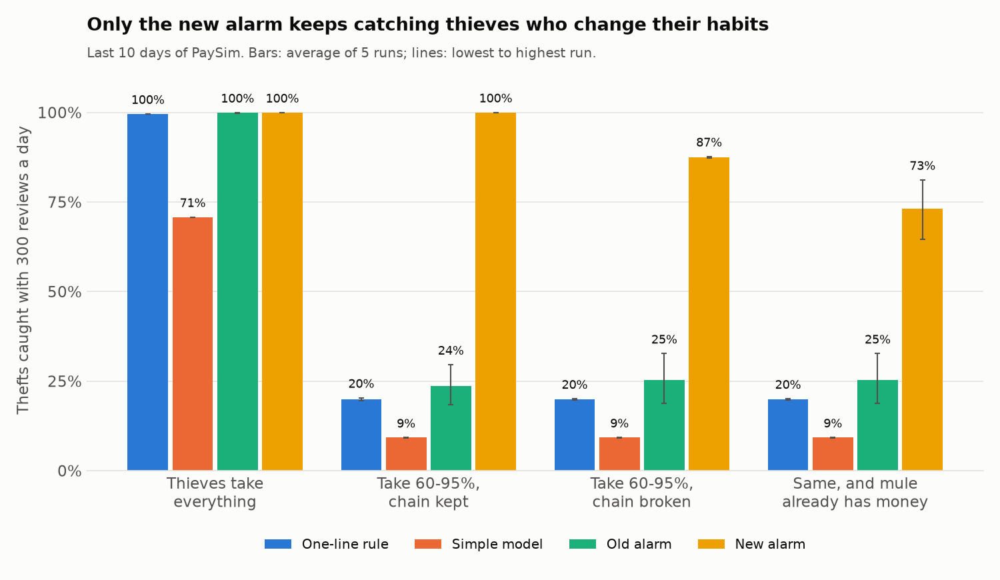
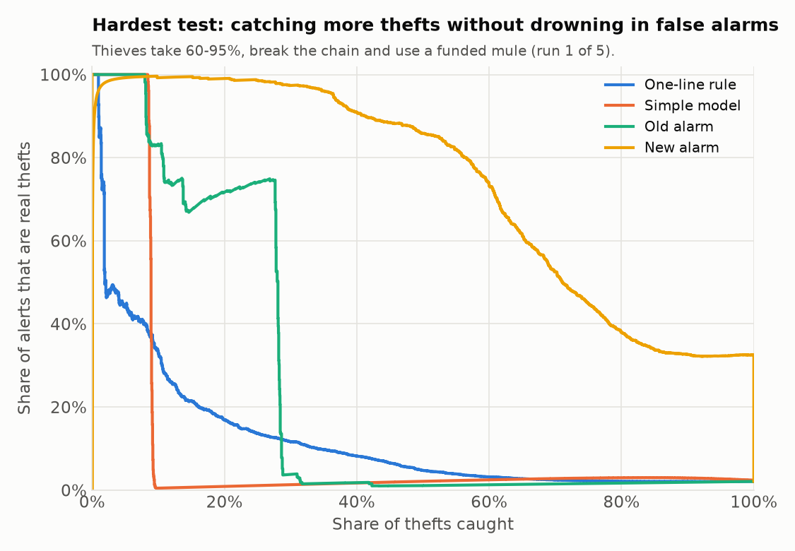

# Mobile money fraud alarm: what "99% accuracy" hides

**Live demo:** https://pixel-perfect-page-615.lovable.app (it runs in your browser; the alarm file is hosted on the Hugging Face Space [BrandyBih/mobile-money-fraud-alarm](https://huggingface.co/spaces/BrandyBih/mobile-money-fraud-alarm))

In 2024 Cameroon handled 65% of all mobile money transactions in the CEMAC zone (BEAC). When a thief gets into a wallet, through a fake MTN or Orange call, a "wrong transfer" SMS or a SIM swap, the money usually leaves the same way: a transfer to a middleman account (a mule), then a cash-out at an agent. An operator has to catch that while it happens, without calling thousands of honest customers.

Public notebooks on this problem often report about 99% accuracy. I took one of them, [fcamuz/fraud-detection-for-mobile-transactions](https://github.com/fcamuz/fraud-detection-for-mobile-transactions), as the starting point, checked the claim, and built an alarm that still works when thieves change their habits.



## Results in short

1. The 99% comes from how it was measured. Balancing the data 50/50 and splitting it at random gives 98.6% accuracy. The same model on the last ten days of real traffic scores 97.9%, below the 99.1% you get by calling every transaction honest, and half of its 5,152 alerts are innocent customers.
2. The data has a giveaway. In PaySim, 97.8% of thefts send the exact balance of the account, and honest transactions never do. A one-line rule catches 99.6% of thefts. So a high score on this data says little about real fraud.
3. Smarter thieves break the old alarms. If thieves leave 5-40% of the money behind, the one-line rule falls to 20% and the original model to about 25%.
4. The new alarm keeps working. With the same 300 reviews a day it catches 87% of these thieves, and 73% (range 65-81% over five runs) when they also use a mule account that already holds money. That still stops 96.5% of the stolen money, because it catches the large thefts first.

## The four tests

All tests use the last ten days of the data (days 22-31), which no model saw during training. A fraud team reviews 300 alerts a day, so 2,987 reviews in total against 2,592 thefts. Each result is the average of five runs with different random seeds; the range is the lowest and highest run.

| How thieves behave | One-line rule | Simple model | Old alarm | New alarm |
|---|---|---|---|---|
| Take the whole balance (as simulated) | 99.6% | 70.8% | 99.9% | 100% |
| Take 60-95%, transfer and cash-out amounts still match | 20.0% | 9.2% | 23.7% (18-30%) | 100% |
| Take 60-95%, amounts no longer match | 20.0% | 9.2% | 25.3% (19-33%) | 87.4% (87-88%) |
| Same, and the mule account already holds money | 20.0% | 9.2% | 25.3% (19-33%) | **73.1% (65-81%)** |

Share of the stolen money stopped in the hardest test: one-line rule 79.4%, simple model 60.4%, old alarm 76.8%, new alarm 96.5%. Over the ten days that is about 3.50 billion of 3.63 billion units kept in customers' accounts, against 3 million for the calls (if each review costs 1,000).



The new alarm was trained on copies of thefts that take 50-95% of the balance, so the middle two rows are close to what it practised. The last row is the fairer test: it never practised against a mule account that already had money.

## How the new alarm works

It is a LightGBM model (a set of decision trees) using only what an operator knows when the request arrives:

- the share of the sender's balance being moved, the amount and the hour
- whether a transfer and a cash-out of the same amount happened within the hour (the mule chain: 63% of thefts against 0.1% of honest transactions)
- the receiving account's balance and history before this payment

Balances recorded after the transaction are left out. They contain simulator quirks that give the answer away.

Each alert comes with its reasons, worked out with SHAP (how much each clue pushed the score up or down), for example "It takes 71% of the money in the account" and "The money goes to a new, empty account".

## What the data can't tell you

PaySim (Lopez-Rojas, Elmir and Axelsson, 2016) is a simulation of one month of a mobile money service in an African country, built from a real operator's logs. It is not MTN or Orange data. Some of its habits are artefacts of the simulator: thieves always empty the account, mule accounts start at zero, about half of honest senders show a zero balance, and honest traffic drops sharply in the last ten days while thefts stay at about 1,850 a week. These numbers show how to build and test an alarm properly. They do not say how well it would work inside a real operator.

## Project layout

| Step | File | What it does |
|---|---|---|
| 1 | `src/prepare.py` | CSV to Parquet with DuckDB, adds request-time features |
| 2 | `src/flawed_replication.py` | Reproduces the "99%" and shows what it hides |
| 3 | `src/baseline.py` | Time split (train days 1-18, tune 19-21, test 22-31), cost-based threshold |
| 4 | `src/robust.py` | The new alarm and the four tests |
| 5 | `src/compare.py`, `src/charts.py` | Four alarms over five seeds, money, charts |
| 6 | `src/explain.py` | SHAP summary chart |
| 7 | `src/scoring.py`, `src/api.py`, `src/app.py` | Scoring with reasons, FastAPI, Streamlit page |
| 8 | `src/export_js.py`, `tests/parity.py` | Browser version of the alarm, checked against Python (2,000 of 2,000 answers identical) |

Notes: [notes/findings.md](notes/findings.md) (all results and quirks), [notes/project_plan.md](notes/project_plan.md).

## Run it

Download the PaySim CSV from Kaggle (`ealaxi/paysim1`, CC BY-SA 4.0) into `data/raw/`, then:

```
python -m venv .venv
.venv/Scripts/pip install -r requirements.txt
.venv/Scripts/python src/prepare.py
.venv/Scripts/python src/flawed_replication.py
.venv/Scripts/python src/baseline.py
.venv/Scripts/python src/robust.py
.venv/Scripts/python src/compare.py
.venv/Scripts/python src/charts.py
.venv/Scripts/python src/explain.py
```

The trained model is in `reports/`, so the app runs without the raw data:

```
.venv/Scripts/python -m streamlit run src/app.py
.venv/Scripts/python -m uvicorn api:app --app-dir src --port 8000
```

## Credit

The question comes from fcamuz/fraud-detection-for-mobile-transactions. It has no open licence, so no code was copied. Data: PaySim on Kaggle. Built by Bih Brandy Sango.
